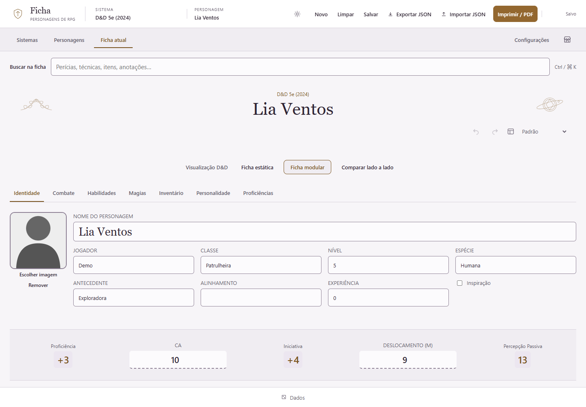
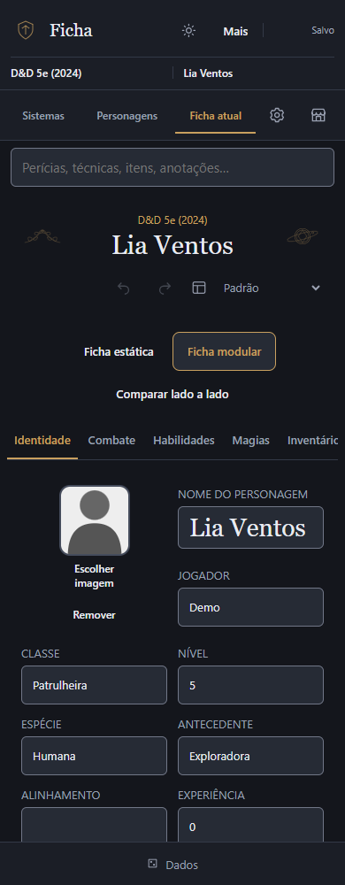
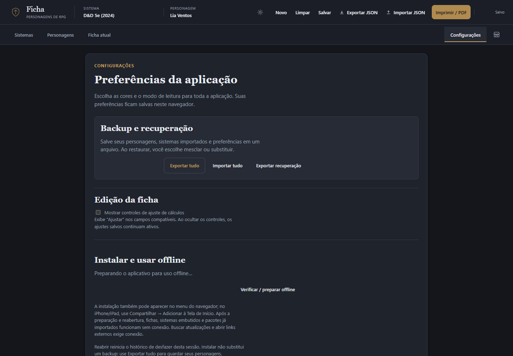
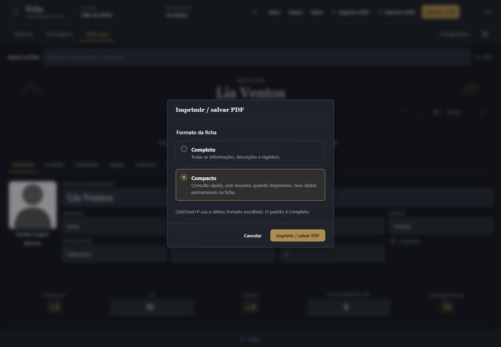

# Ficha RPG

**Versão 0.5.0 — pré-lançamento publicado.** Este checkout também contém avanços locais de autoria posteriores à versão publicada; não representam uma nova release. Novidades e limites em [Histórico de versões](CHANGELOG.md).

**Fichas bonitas, organizadas e prontas para a sessão.**

Crie seus personagens, encontre o que precisa durante o jogo e leve a ficha para o papel. O Ficha RPG reúne organização, personalização e assistência às regras em uma interface feita para computador e celular.

Seu propósito é dar espaço a diferentes sistemas de RPG: desde uma ficha preenchível até uma ficha com cálculos e recursos assistidos. As escolhas e decisões da mesa continuam com você.

O **catálogo local reúne oito sistemas**, cada um com os layouts **Padrão** e **Modo mesa**. Instale os que quiser, edite seus pacotes locais ou importe sistemas próprios em JSON. Consulte [catálogo, edição e exclusão](data/examples/catalog.md).



## Mais tempo jogando

- **Escolha seus sistemas.** O Catálogo permite instalar offline as implementações disponíveis. Em Sistemas, edite o pacote instalado mantendo a base do catálogo intacta, ou exclua o sistema com seus personagens após revisar a confirmação. Reinstalar traz o pacote original, sem recuperar personagens apagados.
- **Monte seu sistema por tarefas.** Use Visão geral, Ficha, Dados, Regras, Testar e Revisar, com [orientação de criação](data/examples/editor-workspace.md). JSON e propriedades completas ficam em Código e propriedades. Em Sistemas, crie um pacote, abra JSON ou edite uma cópia. Experimente campos e ações com personagem fictício isolado, corrija diagnósticos, recupere rascunhos e exporte ou aplique com confirmação. Rascunhos têm download próprio e ficam fora de Exportar tudo. Alterne entre JSON e árvore/propriedades no mesmo rascunho. Consulte [Compor](data/examples/editor-visual.md), o [editor JSON](data/examples/editor-json.md) e a [cobertura dos formulários](data/examples/editor-forms.md).
- **Migre dados com revisão.** Em uma cópia instalada v3, escolha conversões, confira conflitos de todos os personagens e confirme a mudança conjunta com originais recuperáveis. Consulte [migração e restauração](data/examples/data-migration.md).
- **Seus personagens em um só lugar.** Crie, duplique e organize fichas na biblioteca local. Importe e exporte personagens e pacotes de sistemas em JSON. Em Configurações, **Exportar tudo** salva a biblioteca e **Importar tudo** permite mesclar ou substituir com confirmação.
- **Encontre sem percorrer todas as abas.** A busca consulta a ficha inteira, mostra os valores atuais e leva você até o campo, com tolerância a erros de digitação.
- **Acompanhe os recursos da sessão.** Vida, inventário, habilidades, magias e rolagens ficam organizados conforme o sistema escolhido.
- **Consulte entradas sem formulários abertos.** Listas de ataques, magias e habilidades configuradas mostram texto legível e um lápis para editar com Salvar/Cancelar. Usos e preparação podem continuar na ficha. Consulte [modos de edição de entradas](data/examples/entry-editing.md).
- **Faça os testes do seu sistema.** Sistemas compatíveis oferecem painéis com as fontes da ficha e os ajustes do teste, além de botões junto a campos e entradas quando configurados. Os resultados ficam no histórico de rolagens da sessão; custos e decisões da mesa seguem os controles próprios de cada ação.
- **Role a partir das entradas da ficha.** Listas configuradas podem oferecer teste e efeito separados, dados, modificadores, escala e consumo opcional. No D&D, abra uma magia e use **Lançar**, com aumento por espaço e prévia; magias sem dados também podem ser lançadas. Nos cards **Espaços de Magia**, acompanhe o saldo disponível e ative **Consumir espaço ao lançar magia** para descontar do recurso compartilhado. Nos ataques/ações, role ataque e dano separadamente. A bandeja **Dados** aceita expressões como `3d6 + 4` ou `1d8 + 1d6 - 2` nos sistemas que a exibem.
- **Descanse com assistência.** No D&D, **Descanso curto** e **Descanso longo** ficam junto de PV e Dados de Vida, com prévia, confirmação e desfazer. Gaste dados um por vez ou informe o resultado da mesa. Nas habilidades, marque **Recuperar usos em** para incluir somente os recursos que a mesa autoriza. No RPG autoral, itens e artefatos têm **Usos e recuperação** recolhido em Equipamentos/Inventário; somente os itens marcados recuperam seus usos ao descansar.
- **Ajuste os cálculos da mesa.** Em Configurações → **Edição da ficha**, ative **Mostrar controles de ajuste de cálculos** (ocultos por padrão). Em **Ajustar**, escolha um bônus/penalidade ou um valor fixo e volte ao automático quando quiser. Disponível nos resultados calculados, na carga e nos valores derivados de D&D.
- **Acompanhe efeitos com confirmação da mesa.** Em SWADE, ative **Coringa** para aplicar +2 nos testes de traço e dano e confirme o fim da rodada para encerrá-lo. Os valores-base permanecem editáveis. Cartas, iniciativa e demais decisões continuam manuais; consulte a [cobertura dos efeitos](data/examples/effects.md).
- **Assistência quando ela ajuda.** Cálculos, criação e evolução têm controles próprios nos sistemas compatíveis. Edição direta durante o jogo não cobra evolução automaticamente.
- **Consulte também no celular.** Abas, cartões e tabelas se reorganizam para telas menores; as ações do cabeçalho ficam no menu **Mais**.
- **Escolha a apresentação para a sessão.** Em **Layout da ficha**, alterne entre Padrão e **Modo mesa** nos sistemas embutidos. A versão de mesa reúne recursos, ações e consulta rápida com os mesmos dados. A escolha fica salva por sistema; campos fora dela continuam acessíveis pela busca e pelo layout completo.
- **Corrija edições com desfazer e refazer.** Use as setas junto ao layout ou Ctrl/⌘ Z e Ctrl/⌘ Shift Z. O histórico guarda até 50 operações por personagem durante a sessão da página, incluindo recursos e registros de ações; recarregar a página reinicia o histórico, mantendo a ficha salva. Consulte [cobertura e limites](data/examples/history.md).
- **Leve o app para uma sessão sem rede.** Em Configurações → **Instalar e usar offline**, aguarde o status **Disponível offline**. Sistemas embutidos, pacotes já importados, edições e arquivos locais funcionam offline. Instale pelo botão quando o navegador oferecer ou pelo seu menu. Consulte [instalação, atualizações e limites](data/examples/offline.md).

## Uma ficha com a sua cara

A ficha modular organiza seus componentes numa superfície contínua, com títulos e espaçamento separando os assuntos. Biblioteca e catálogo usam linhas com ações e estados visíveis. O **Modo mesa** mantém uma composição mais compacta para consulta, compartilhando os mesmos dados com a apresentação completa.

Escolha entre seis paletas — Clássico, Editorial, Floresta, Rubi, Preto e branco e Pétalas — em modo claro ou escuro. Combine ornamentos, posições e intensidade, ou mantenha uma apresentação simples. Os dados podem aparecer em texto ou com ícones vetoriais acompanhados de texto. Sistemas com passos de dados podem habilitar botões **−/+** para descer ou subir na escala, inclusive cada dado de um traço composto.

Em **Configurações → Fundo**, escolha Sólido, Translúcido ou Usar transparência do navegador. Menus e janelas têm materiais discretos, com redução de efeitos disponível. Consulte [funcionamento, preferências e limites](data/examples/appearance.md).

No modo claro, fundo off-white, navegação sutil e campos quase brancos se distinguem por divisórias e bordas discretas. Cada paleta mantém a cor nos destaques; Preto e branco conserva superfícies neutras. Campos têm foco único; escolhas exclusivas usam círculos, e escolhas independentes usam checkboxes. A recuperação oferece Ajuste manual como opção explícita.

<table>
  <tr>
    <td align="center"></td>
    <td align="center"></td>
  </tr>
  <tr><td align="center">Para consultar durante a sessão</td><td align="center">Cores e apresentação do seu jeito</td></tr>
</table>

## Do navegador para a mesa

Em **Imprimir / PDF**, escolha **Completo** para levar as informações detalhadas ou **Compacto** para uma versão de consulta com os resumos disponíveis no layout. No D&D compacto, por exemplo, magias ficam com nome e nível e moedas ocupam menos espaço.

O documento adapta a identidade visual da ficha ao papel A4 e inclui o conteúdo definido para o formato escolhido, mesmo que haja abas fechadas ou filtros ativos na tela. Salve como PDF pelo diálogo de impressão do navegador. O JSON continua sendo o arquivo para backup e reimportação.

<p align="center"></p>

## Sistemas disponíveis

| Sistema | O que oferece |
| --- | --- |
| D&D 5e (2024) | Ficha modular com atributos, perícias, recursos, magias, inventário e cálculos. Também oferece a ficha estática e a comparação lado a lado, com os mesmos dados. |
| RPG autoral em desenvolvimento | Ficha assistida com criação por pontos, evolução, técnicas, recursos, estados e Pool. Seu conteúdo tem direitos próprios, separados da engine. |
| Fate Acelerado | Aspectos, abordagens, façanhas, estresse e consequências; teste de 4dF contra oposição. |
| Cthulhu 7e | Investigador, perícias e recursos; testes percentuais com bônus/penalidade, conforme o Quick-Start consultado. |
| Blades in the Dark | Ações, resistências calculadas, estresse, dano e relógios; pools de d6 do SRD original. |
| Savage Worlds SWADE | Traços, recursos e derivados; dados explosivos, dado selvagem, ampliações e efeito Coringa com ativação e encerramento confirmados, conforme o Test Drive 2020. |
| Ironsworn | Recursos, ímpeto e trilhas; testes de ação e progresso do SRD original. |
| Ordem Paranormal | Ficha preenchível baseada nos campos da ficha oficial pública. Regras e totais manuais. |
| Seus sistemas | Importação de pacotes com dados e layouts configuráveis. Componentes compatíveis podem ser reutilizados; mecânicas novas podem exigir implementação adicional. |

**O projeto está em desenvolvimento**, ainda sem lançamento de produção. A cobertura depende do sistema; não há automação integral de livros nem suporte universal a toda mecânica. O [editor visual](data/examples/editor-visual.md) oferece autoria dos mecanismos atuais, com cobertura e limites por família.

Os seis sistemas adicionais oferecem Padrão e Modo mesa. Consulte [referências, cobertura e regras manuais](data/examples/additional-systems.md): criação, evolução, custos e decisões narrativas não são aplicados automaticamente.

## Comece sua ficha

1. Em **Sistemas**, use **Abrir** no sistema desejado. Depois, em **Personagens**, escolha **Novo personagem** para criar uma ficha nesse sistema.
2. Preencha o personagem e escolha **Layout da ficha** no cabeçalho para alternar entre Padrão e Modo mesa.
3. Use a busca para localizar campos e **Configurações** para ajustar a aparência.
4. Salve uma cópia com **Exportar JSON** ou faça o backup da biblioteca em Configurações → **Exportar tudo**.

Consulte e altere [fontes, vínculos e grafo de regras](data/examples/rule-connections.md) por menus ou cabos; as edições não confirmadas ficam no rascunho.

Para montar uma ficha própria, abra **Sistemas** → **Criar pacote** → **Compor**. O pacote começa vazio em v3. Crie dados opcionais em **Dados tipados e vínculos**, reutilize o mesmo valor em componentes diferentes e construa cálculos por operações ou pela receita “a cada N”. Consulte o [primeiro vínculo e contrato v3](data/examples/typed-data.md) e as [consultas e cálculos visuais](data/examples/rule-queries.md). Use os cards da toolbox, a prévia e as receitas de lógica; **Experimentar** permite ensaiar com dados fictícios. Consulte [autoria visual e limites](data/examples/editor-visual.md).

Para acrescentar um pacote de arquivo, abra **Sistemas** → **Importar sistema**. Há [exemplos importáveis e contratos](data/examples/README.md) para quem deseja configurar regras e layouts.

Em pacotes v3, componha também [registros, coleções e grupos](data/examples/structured-data.md): campos com identidades próprias, referências a catálogos, repetição por entrada e compostos locais compartilhados. Orientações podem aparecer sem criar um dado no personagem.

Use [condições compartilhadas](data/examples/predicates.md) para mostrar componentes, permitir sua edição ou autorizar ações. Ocultar preserva os valores; executar uma ação verifica novamente a permissão atual.

Configure [ações tipadas e resoluções](data/examples/action-flows.md) com entradas da mesa, grupos de dados, seleção, rerrolagem, custos por resultado e consequências. Escolha prévia integral ou ativação com pagamento anterior aos dados; registros v3 permitem retomar execuções guardadas.

Acrescente [eventos e gatilhos locais](data/examples/rule-events.md) com origens explícitas, cruzamentos, frequência e prévia causal. Custos e consequências entram na mesma confirmação; escolhas podem ficar em propostas para revisão.

Projete valores temporários com [efeitos tipados](data/examples/typed-effects.md): substituição, multiplicadores, passos de traço e duração por uso ou evento confirmado, preservando a base.

Configure [criação, evolução e concessões](data/examples/progression-choices.md) com requisitos, orçamento, escolhas e benefícios registrados por origem. Edição direta continua separada de compras.

## Seus dados

A biblioteca e as preferências ficam no navegador, sem conta ou backend. Não há sincronização entre dispositivos ou backup em nuvem. **Use Exportar tudo regularmente**: limpar os dados do site ou trocar de navegador/endereço pode tornar a biblioteca anterior indisponível. O backup inclui personagens, sistemas importados e preferências; sistemas embutidos acompanham o app. Se uma gravação falhar, a ficha continua em memória e pode ser exportada. Os arquivos exportados podem conter nomes, notas, imagens e dados de recuperação; revise-os antes de compartilhar.

Novos retratos são reduzidos e comprimidos para ocupar menos espaço. Imagens externas importadas permanecem nos dados, mas não são carregadas automaticamente.

Importações verificam formatos, referências e limites antes da gravação. Conversões de nomes antigos reconhecidos pedem confirmação e preservam uma cópia do original. Documentos de versões ainda não suportadas ficam protegidos contra sobrescrita; consulte a [política de validação e preservação](data/examples/validation.md).

As imagens deste README são capturas reais da interface com dados fictícios, feitas em um contexto de navegador isolado.

## Experimentar localmente

Requisitos: Node.js 22 ou superior, npm e um navegador moderno.

```sh
npm ci
node tests/static-server.mjs
```

Abra [http://127.0.0.1:4173](http://127.0.0.1:4173). Encerre o servidor com `Ctrl+C`. Use HTTP: abrir `index.html` diretamente por `file://` não é o fluxo suportado.

Instalação e uso offline exigem HTTPS ou um endereço local confiável, além de um navegador compatível. Após alterar o runtime, regenere o worker com `npm run build:offline` e verifique com `npm run check:offline`. Uma atualização preparada aparece no aviso **Atualizar agora**, que salva alterações e rascunhos antes de reabrir as abas. Uma aba com a versão antiga do procedimento pode exigir fechamento uma vez; seus dados locais permanecem. Os testes fazem essa geração automaticamente antes de iniciar o servidor.

O servidor é para desenvolvimento e serve o repositório inteiro. Não o exponha à internet nem hospede a pasta inteira: memória interna, referências e dados privados não devem integrar uma distribuição.

## Para quem desenvolve

As verificações de autoria geral, medições reproduzíveis e limites de avaliação estão em [verificação da autoria](data/examples/authoring-validation.md).

HTML, CSS e JavaScript com módulos ES, sem framework de interface. A engine declarativa separa **sistema** (dados e regras), **layout** (apresentação) e **personagem** (valores e escolhas). Sistemas usam JSONs distintos de layout e configuração, reunidos em pacotes `rpg-system-package` na importação/exportação, com `schemaVersion`.

A implementação está em `js/engine/`, os repositórios em `js/repositories/` e os contratos em `js/validation/schemas.js`. Regras específicas permanecem em componentes próprios quando necessário. Não se promete representar qualquer livro só com JSON. Pacotes podem oferecer vários layouts selecionáveis, com `name` opcional e `mode: "table"` para mesa; consulte o [contrato de layouts e modo mesa](data/examples/layouts.md).

Listas podem habilitar o painel genérico com `entryAction: "roll"` e `rollPreset` apontando para uma configuração em `system.entryRolls`. Dados, modificadores por campo/fórmula, escala, textos e consumo opcional vêm do JSON. D&D usa o mesmo painel; somente seus derivados de conjuração têm um resolvedor específico. Consulte o [contrato e exemplo de rolagens configuráveis](data/examples/README.md). A bandeja de expressões atende todos os sistemas; `diceTray: false` a oculta.

O componente `recoveryGroup` apresenta ações declaradas em `system.recoveryActions`, com recuperação por dados, valores e listas. Regras D&D ficam no JSON e em seu resolvedor de Constituição. Consulte o [contrato e exemplo de recuperações](data/examples/recovery.md).

`checkRoll` usa algoritmos de teste configurados em `system.checks`, com fontes de campos, coleções ou fórmulas. Resultados entram no histórico de rolagens sem modificar o personagem. Consulte o [contrato e exemplo importável](data/examples/additional-systems.md#contrato-de-testes-sob-demanda).

As rolagens usam `crypto.getRandomValues()` do navegador, com intervalos iguais por face e descarte da sobra para evitar viés. Funcionam offline; não recorrem a `Math.random()` se a API estiver indisponível. Isso melhora a imprevisibilidade, mas não certifica resultados perante outros jogadores.

Campos e entradas identificadas podem oferecer botões de teste configurados em `roll`, reutilizando esse painel e suas fontes. Os resultados guardam a configuração e a resolução no histórico transitório. Veja o [pacote de exemplo](data/examples/check-buttons.package.json).

Efeitos numéricos têm ativação explícita, duração manual ou encerramento confirmado pela mesa. O piloto é o Coringa de SWADE: bônus em testes de traço e dano, sem automatizar cartas, iniciativa ou recursos. Valores-base continuam editáveis; ajustes somam após efeitos e valores fixos determinam o resultado final. Consulte o [contrato de efeitos](data/examples/effects.md).

A [política de validação e versões](data/examples/validation.md) descreve formatos suportados, diagnósticos e normalizações confirmadas com cópia recuperável. Documentos de versões futuras permanecem protegidos contra gravação. Metadados seguros desconhecidos são preservados; opções executáveis desconhecidas exigem correção antes de uso.

A [referência dos componentes e parâmetros](data/examples/components-reference.md) é gerada dos descritores usados pela validação. `npm run build:reference` atualiza Markdown/JSON e `npm run check:reference` confere sua correspondência com contratos, exemplos e arquivos de origem. Não constitui um JSON Schema completo nem um editor de sistemas.

`computed` (sem `mode: "roll"`) e `inventorySummary` aceitam `override: false` para desativar ajustes e `overrideKey` para identificar resultados distintos que compartilham a mesma fórmula. Ajustes persistem no personagem em `calculationOverrides`, como `{ "computed.capacity": { "mode": "adjust", "value": 2 } }`; `fixed` substitui o resultado e remover a entrada devolve o automático. `inventorySummary.overrideKeys` permite vincular peso/capacidade/sobrecarga ao ID de outro resultado calculado. No sistema, `diceSteps: true` habilita passos nos campos de dados; `stepControls: false` os desativa por campo, inclusive em `itemSchema`. A escala deve ser positiva, crescente e sem repetições. D&D mantém esses passos desligados.

Os testes usam Playwright com Microsoft Edge instalado. Pare o servidor manual antes de executar:

```sh
npm run test:quick
npm run test:full
```

Não execute suítes concorrentes na porta 4173. Para usar Chromium, ajuste o `channel` em `playwright.config.js` e instale o navegador correspondente pelo Playwright. Capturas e traces de testes ficam em `test-results/`, sem versionamento. Os prints de apresentação podem ser regenerados com `node scripts/capture-readme.mjs`, que usa a porta 4175.

`test:unit` verifica regras e contratos sem navegador. `test:quick` acrescenta os percursos essenciais; `test:full` inclui todos os Playwright, documentação e cache offline. A [organização dos testes](data/examples/testing.md) explica a seleção e a cobertura preservada.

Para conferir somente a documentação e os arquivos gerados, use `npm run check:docs` e `npm run check:offline`.

A documentação de trabalho, os planos e os relatórios ficam privados e não acompanham o clone. Este README apresenta o produto e os passos essenciais para executá-lo.

## Direitos de uso

O código original da aplicação e da engine tem [licença própria de uso não comercial com atribuição](LICENSE). Uso, modificações e compartilhamento gratuito não comercial são permitidos nos termos da licença; exploração comercial exige autorização escrita. Não é uma licença MIT ou Apache-2.0.

Conteúdos de RPG, artes, marcas e materiais de terceiros têm direitos separados. O projeto é independente e não oficial, sem afiliação à Wizards of the Coast. A licença do código não libera livros, traduções ou desenhos. Consulte os [avisos de terceiros](THIRD_PARTY_NOTICES.md) e o [registro de direitos das artes](assets/artwork/README.md).
